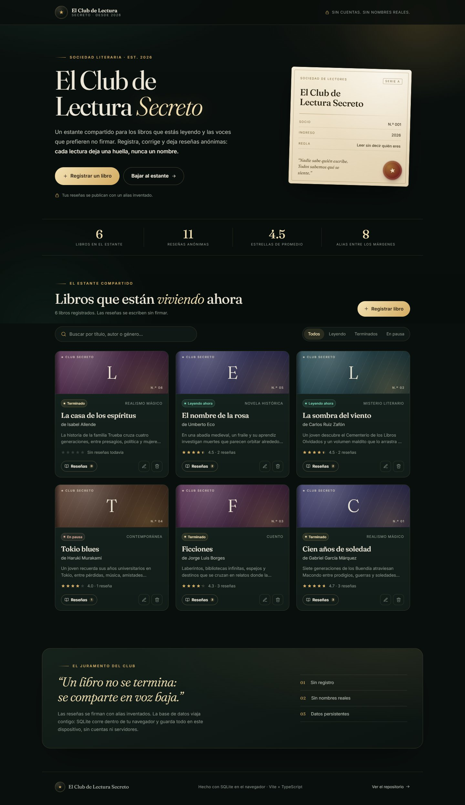
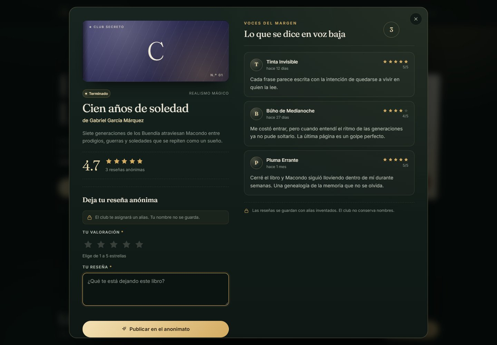

# El Club de Lectura Secreto

Aplicación web para registrar los libros que estás leyendo y dejar reseñas anónimas con una valoración de 1 a 5 estrellas.

- **Sitio:** https://clubdelecturasecreto.vercel.app/
- **Repositorio:** https://github.com/Aguilar-21/club-de-lectura-secreto



## Funciones

- Registrar libros con título, autor, género, estado de lectura y una sinopsis corta.
- Editar y eliminar libros. Si se elimina un libro, también se borran sus reseñas.
- Escribir reseñas sin poner el nombre. La aplicación asigna un alias como "Pluma Errante".
- Ver el promedio de estrellas de cada libro y cuántas reseñas tiene.
- Buscar por título, autor o género, y filtrar por estado de lectura.
- Los datos quedan guardados en el navegador, así que siguen ahí al recargar la página.

## Tecnologías

- Vite y TypeScript.
- SQLite con sql.js, que ejecuta la base de datos en el navegador mediante WebAssembly.
- CSS para el diseño y la adaptación a móvil.
- Vercel para publicar el sitio.

## Base de datos

Uso tres tablas: `autores`, `libros` y `resenas`. La tabla `libros` tiene una clave foránea hacia `autores`, y `resenas` hacia `libros`, con borrado en cascada.

Como Vercel no permite escribir archivos, la base se ejecuta en el navegador con sql.js. Después de cada cambio se exporta y se guarda en `localStorage`. Al abrir la página se vuelve a cargar, y por eso los datos no se pierden al recargar.

La primera vez se cargan algunos libros y reseñas de ejemplo para que el sitio no aparezca vacío. Se pueden editar o eliminar igual que los demás.

## Cómo ejecutarlo

```bash
npm install
npm run dev
```

Para compilar y probar la versión final:

```bash
npm run build
npm run preview
```

## Estructura

```text
src/
├── db/database.ts        conexión con SQLite, tablas y guardado
├── models/               consultas de autores, libros y reseñas
├── views/                HTML de la página, tarjetas y formularios
├── controllers/          eventos, formularios y acciones
├── styles/styles.css     estilos
└── main.ts               inicio de la aplicación
```

## Despliegue

El proyecto está publicado en Vercel. Para desplegarlo de nuevo: importar el repositorio, usar `npm run build` y la carpeta `dist` como salida. No necesita variables de entorno.

## Capturas

Detalle de un libro con sus reseñas:



Vista móvil:


